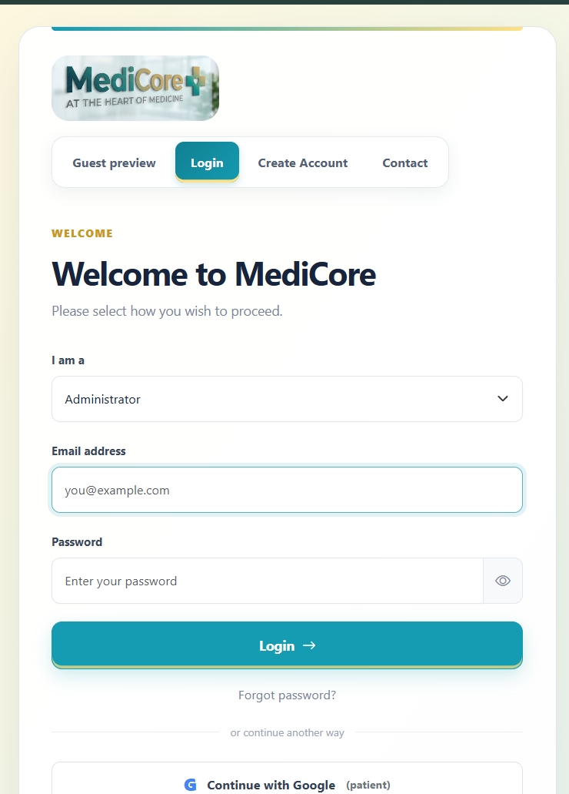
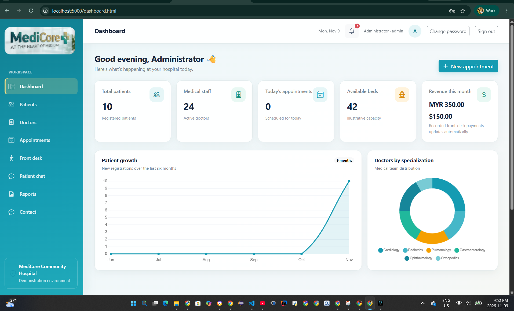
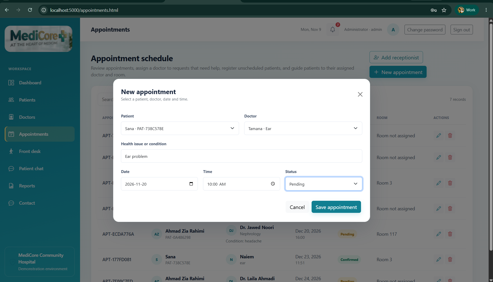
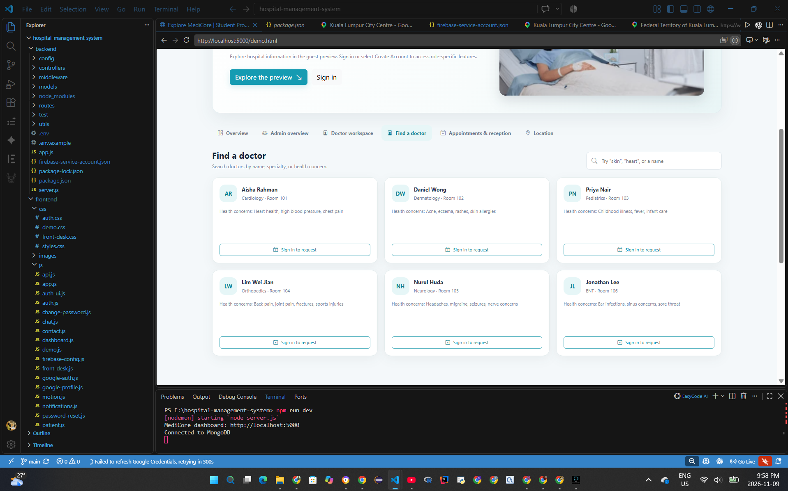

# MediCore Hospital Management System

A full-stack hospital management dashboard and REST API built for the Full-Stack Development Internship Level 1 Task 2. Patients can register and book appointments; doctors, receptionists, and administrators sign in to their role-specific workspace.

## Project overview

MediCore Community Hospital is the fictional name used by this prototype. It provides role-based interfaces for patients, doctors, receptionists, and administrators. The browser dashboard is served by the Express application, while MongoDB Atlas stores accounts and operational records. The teal-and-white responsive interface includes summary cards, search and filters, record modals, analytics, and printable reports.

​‌
​‌



## Features

- Responsive healthcare admin interface with sidebar navigation, dashboard, patients, doctors, appointments, and reports.
- Patient, doctor, and appointment CRUD workflows with search, detail view, and modal forms.
- Patient gender, doctor specialization, and appointment status filters.
- Appointment status badges, input validation, and confirmation before deletion.
- MongoDB-backed data models with generated human-readable record IDs and timestamps.
- Dashboard cards for patient and doctor totals, today's appointments, and available beds.
- Patient growth, monthly appointment, and doctor-by-specialization charts; monthly reports.
- JSON API responses, centralized error handling, and standard HTTP status codes.
- Password-hashed sign-in, signed expiring sessions, and role-based API authorization.
- Patient self-registration with a private profile and appointment booking. Doctor applicants can submit a registration request, but an administrator must verify and approve it before doctor access is activated.
- Patient doctor directory searchable by name, specialty, and administrator-maintained doctor health-concern lists; specialty suggestions are not medical advice.
- Fourteen fictional sample doctors are added on server startup and can be searched and booked by name or specialty.
- Each doctor has a room number. Receptionists can review appointments and direct patients to the booked doctor's room; patients and doctors see the same room number.
- In-app notifications alert patients and relevant staff about appointment changes, doctor registrations awaiting review, and receptionist check-ins/payments. The dashboard bell shows unread updates and polls for new notifications.
- The patient and appointment pages show a map link for the prototype location: 12 Jalan Medika, Kuala Lumpur, Malaysia.
- Guests can explore an interactive sample website without an account. Google sign-in and patient sign-up are available when Google OAuth is configured.
- Illustrative available-bed and revenue figures; replace these with facility data before operational use.

## Technologies

- **Backend:** Node.js, Express, MongoDB Atlas, Mongoose, dotenv, cors, nodemon
- **Frontend:** HTML, CSS, JavaScript, Bootstrap 5, Bootstrap Icons, Chart.js
- **API testing:** Postman or Thunder Client

## Requirements

- Node.js 18 or later and npm
- A MongoDB Atlas cluster (or a MongoDB-compatible URI)

## Installation and run

1. Clone the repository and open its root directory.
2. Install backend dependencies from the project root:

   ```bash
   npm run setup
   ```

3. Copy `backend/.env.example` to `backend/.env` and set your MongoDB connection string:

   ```env
   PORT=5000
   MONGODB_URI=mongodb+srv://<username>:<password>@<cluster-url>/hospital_management?retryWrites=true&w=majority
   CLIENT_ORIGIN=http://localhost:5000
   AUTH_TOKEN_SECRET=<random secret of at least 32 characters>
   INITIAL_ADMIN_EMAIL=<your administrator email>
   INITIAL_ADMIN_PASSWORD=<unique password of at least 12 characters>
   APP_BASE_URL=http://localhost:5000
   EMAIL_HOST=<your SMTP server>
   EMAIL_PORT=587
   EMAIL_SECURE=false
   EMAIL_USER=<your SMTP username>
   EMAIL_PASSWORD=<your SMTP app password>
   EMAIL_FROM=<verified sender address>
   # Optional fallback if your network DNS blocks MongoDB SRV lookups:
   MONGODB_DNS_SERVERS=1.1.1.1,8.8.8.8
   ```

   In Atlas, create a database user and allow the development machine's IP in Network Access. Keep `.env` private; never commit credentials.

   Generate a token secret, for example with `node -e "console.log(require('crypto').randomBytes(32).toString('hex'))"`. Set the initial admin email and password before the first start. The first admin account is created only when MongoDB connects and no admin account exists. Use a unique password; do not use the example placeholders.

   Password recovery uses a one-time email link that expires after 30 minutes. Configure these email settings with your provider; use an app password where supported, never your regular email password. Set `APP_BASE_URL` to the public site URL after deployment. Keep all email credentials private. The public Contact form submits to Formspree; manage its recipient and submissions in your Formspree account.

4. Start the application from the project root:

   ```bash
   npm run dev
   ```

5. Open [http://localhost:5000](http://localhost:5000) for sign-in. Choose **Continue as a guest** for the demo, or sign in to a role-based workspace. The server serves the frontend and API on the same origin. Check [http://localhost:5000/api/health](http://localhost:5000/api/health) to verify the API is responding and see its MongoDB connection state.

The sign-in and registration pages offer **Continue as a guest**, which opens an interactive demo with fictional doctors, appointments, and each doctor's fixed room number. Preview changes are held in the browser and are not saved to the database.

### Configure Google sign-in

Google sign-in and patient sign-up need an OAuth 2.0 Web application in Google Cloud Console. Set these values in `backend/.env` (do not share or commit the client secret):

```env
GOOGLE_CLIENT_ID=<your Google OAuth client ID>
GOOGLE_CLIENT_SECRET=<your Google OAuth client secret>
GOOGLE_REDIRECT_URI=http://localhost:5000/api/auth/google/callback
```

Add the same callback URL to the OAuth client's authorized redirect URIs, then restart the server. For deployment, use the HTTPS callback URL on the deployed host instead. Users choose their Google account and sign in with its verified email. First-time Google users can explore the patient page immediately; they must complete the remaining patient details (age, gender, phone, and address) before requesting an appointment. Without these settings, Google sign-in cannot run; the guest preview remains available.

On the first successful database connection, the server adds fourteen sample doctors if they are not already present. They have fictional contact details and do not have sign-in accounts. The sample records make the patient search and booking flows demonstrable; verify real providers before using this system for actual care.

### Sign-in and role access

- **Administrators** sign in with the initial account configured in `backend/.env`. They have full access to the dashboard, patient, doctor, appointment, and reports sections. From the Appointment schedule, an administrator can create receptionist accounts. On the Doctors page, review doctor registration requests and verify professional credentials before approval. Add each doctor's qualified health concerns to their record so patients can find them by those terms. New doctors can also be added with an account, and existing doctor records can be linked to a sign-in.
- **Doctors** sign in using the email and temporary password assigned by an administrator. They can view patient records, see only their own appointments, and change the status of those appointments.
- **Receptionists** sign in with an account created by an administrator using **Add receptionist** on the Appointment schedule page. Their workspace includes patient, doctor, and appointment records: they can register walk-in patients, create and update patient and doctor profiles, schedule appointments, update appointment details, and guide patients to the assigned doctor's room. They cannot delete records, approve doctor applications, create staff accounts, or view reports; those actions remain administrator-only.
- **Front desk** is available to receptionists and administrators. Register walk-in patients without creating an appointment, record the amount already collected in MYR or USD, and print or save a receipt showing the patient's name, patient ID, visit date, condition, payment method, and amount. This records a payment only; it does not process a card or online transaction, and card details must never be entered.
- **Patients** can create an account from the sign-in page. Registration creates a new patient profile; patients can see only their own profile and appointments and can request appointments with a doctor.
- **Contact** is available from the sign-in, registration, demo, and patient pages. Patient messages are sent to the configured Formspree form; confirm the destination email and test the form in Formspree before sharing it with patients.
- **Doctor applicants** can register from the same page. Their password is stored as a hash, and no doctor account or record access is granted until an administrator approves the request. After approval, the doctor can sign in with the password they submitted.
- Administrators can also create patient sign-in accounts linked to existing patient records from the Patients page.
- Patient, doctor, and receptionist APIs require a valid session. Patient registration, doctor application submission, and sign-in are public account endpoints; receptionist accounts and doctor access/review actions require administrator authorization. The initial admin is provisioned from server environment settings, not public signup. Sessions expire after eight hours; signing out invalidates the session.
- Users can change their password from the account menu; changing it invalidates previous sessions.

Existing patient records are not automatically linked to a newly registered account; an administrator must create a linked sign-in for those records. This sample application does not include email verification, password recovery, multi-factor authentication, login rate limiting, or clinical identity verification. It is not production-ready for real patient information; production deployment also requires HTTPS, security monitoring, and applicable privacy/compliance controls.

The displayed address, map search, sample doctor names, and sample contact details are fictional prototype data and do not identify a real hospital or medical providers. Replace them with verified information before sharing the site with patients.

The API starts even when MongoDB is not configured, so the sign-in page and health check remain available. Database-backed endpoints return `503` with setup guidance until a valid Atlas URI is configured. If Atlas is temporarily unreachable after an URI is configured, the backend retries the connection with an increasing delay. The database collections (`users`, `patients`, `doctors`, `doctorapplications`, `appointments`, `visits`, and `notifications`) are created automatically when the first records are added. The dashboard's available-bed count is an illustrative sample value; admin revenue totals use recorded front-desk payments, shown separately in MYR and USD without currency conversion.

If the backend reports `querySrv ECONNREFUSED` but Atlas Network Access and the URI are correct, the local DNS resolver may block MongoDB SRV records. Set `MONGODB_DNS_SERVERS=1.1.1.1,8.8.8.8` in `backend/.env` to use Cloudflare/Google DNS for Node.js SRV lookups, then restart the backend. Your network must permit DNS queries to those servers.

### Deploy as one website and API

The included [`render.yaml`](./render.yaml) configures a single, paid Render Starter web service intended to stay awake; a free instance can sleep and is unsuitable if you need an always-responsive API. Create a Render Blueprint from this repository and set `MONGODB_URI`, `AUTH_TOKEN_SECRET`, `INITIAL_ADMIN_EMAIL`, and `INITIAL_ADMIN_PASSWORD` when prompted. Use a unique random token secret and strong unique admin password. Configure the Atlas database user and allow the service's outbound IP addresses in Atlas Network Access. Wait until `/api/health` reports `"database":"connected"` before signing in. Do not deploy the HTML pages as a standalone static site: they need the Express API and Atlas database. Never commit secrets.

Hosting cannot promise literal 100% uptime. The paid always-on service avoids free-tier idle sleep, and the server retries temporary Atlas connection failures, but saving still requires the hosting provider, network, and MongoDB Atlas to be available.

### Automated API checks

From the project root, run:

```bash
npm test
```

These tests verify the health endpoint, authentication requirements, session signing, password hashing, role checks, JSON error handling, and database setup responses without requiring a live MongoDB instance. Full CRUD persistence and dashboard aggregation checks require a reachable MongoDB instance.

## API endpoints

All endpoints are prefixed with `/api`. Successful list responses have the shape `{ "success": true, "count": 0, "data": [] }`; single-resource responses use `{ "success": true, "data": {} }`. Errors return `{ "success": false, "message": "..." }`.
Except for `/health`, `/auth/register`, and `/auth/login`, endpoints require a signed-in session and enforce the role permissions described above.

| Method | Endpoint | Description |
|---|---|---|
| GET | `/api/health` | API health check and MongoDB connection state |
| POST | `/api/auth/register` | Public patient registration |
| POST | `/api/auth/login` | Sign in |
| GET | `/api/auth/google` | Start Google OAuth sign-in or patient sign-up |
| GET | `/api/auth/google/callback` | Complete Google OAuth and create the session |
| POST | `/api/auth/google/complete-profile` | Complete the patient profile after Google sign-up |
| GET | `/api/auth/me` | Current signed-in user |
| POST | `/api/auth/logout` | Invalidate current session |
| POST | `/api/auth/change-password` | Change password and rotate the current session |
| POST | `/api/auth/doctor-accounts` | Admin creates a doctor profile and sign-in |
| POST | `/api/auth/doctor-accounts/:id` | Admin creates a sign-in for an existing doctor |
| POST | `/api/auth/patient-accounts/:id` | Admin creates a sign-in for an existing patient |
| POST | `/api/auth/receptionist-accounts` | Admin creates a receptionist sign-in |
| GET | `/api/dashboard` | Dashboard metrics and chart series |
| GET | `/api/notifications` | List the signed-in user's recent notifications and unread count |
| PATCH | `/api/notifications/:id/read` | Mark one notification as read |
| PATCH | `/api/notifications/read-all` | Mark all notifications as read |
| GET | `/api/reports` | Registration, appointment, and monthly report data |
| GET | `/api/patients` | List patients |
| GET | `/api/patients/:id` | Get a patient by MongoDB ID |
| POST | `/api/patients` | Create a patient |
| PUT | `/api/patients/:id` | Update a patient |
| DELETE | `/api/patients/:id` | Delete a patient |
| GET | `/api/doctors` | List doctors |
| GET | `/api/doctors/:id` | Get a doctor by MongoDB ID |
| POST | `/api/doctors` | Create a doctor |
| PUT | `/api/doctors/:id` | Update a doctor |
| DELETE | `/api/doctors/:id` | Delete a doctor |
| GET | `/api/appointments` | List appointments with patient and doctor details |
| GET | `/api/appointments/:id` | Get an appointment by MongoDB ID |
| POST | `/api/appointments` | Create an appointment |
| PUT | `/api/appointments/:id` | Update an appointment |
| DELETE | `/api/appointments/:id` | Delete an appointment |

### Example request bodies

`POST /api/patients`:

```json
{
  "fullName": "Jordan Lee",
  "age": 34,
  "gender": "Other",
  "phone": "+1 555 0100",
  "address": "100 Main Street",
  "disease": "Annual checkup",
  "admissionDate": "2026-11-03"
}
```

`POST /api/doctors`:

```json
{
  "fullName": "Dr. Taylor Morgan",
  "specialization": "Cardiology",
  "phone": "+1 555 0101",
  "email": "taylor.morgan@example.com",
  "availability": "Mon–Fri, 9:00 AM–4:00 PM"
}
```

`POST /api/appointments` (use MongoDB `_id` values returned by the patient and doctor endpoints):

```json
{
  "patient": "<patient-mongodb-id>",
  "doctor": "<doctor-mongodb-id>",
  "appointmentDate": "2026-11-10",
  "appointmentTime": "10:30",
  "status": "Pending"
}
```

Responses use `200` for reads/updates/deletes, `201` for creation, `400` for invalid input, `404` for missing routes or records, and `500` for unexpected server errors.

## Database schema

Mongoose creates these collections on the first successful write (MongoDB collection names are lowercase and plural):

| Collection | Fields |
|---|---|
| `users` | `email` (unique), password hash, optional unique Google subject, `role` (`admin`, `doctor`, `patient`, `receptionist`), optional doctor/patient reference and display name, token version, timestamps |
| `patients` | `patientId` (generated, unique), `fullName`, `age`, `gender`, `phone`, `address`, `disease`, `admissionDate`, timestamps |
| `doctors` | `doctorId` (generated, unique), `fullName`, `specialization`, `roomNumber`, `phone`, `email` (unique), `availability`, timestamps |
| `appointments` | `appointmentId` (generated, unique), `patient` (Patient reference), `doctor` (Doctor reference), `appointmentDate`, `appointmentTime`, `status` (`Pending`, `Confirmed`, `Cancelled`), timestamps |

Live Website: https://medicore-hospital-management-ei30.onrender.com

Project Demonstration Video: https://drive.google.com/file/d/1QbaxsOjM3sdVfDJALqgSu4kv542LQ_DQ/view?usp=sharing


## API testing with Postman or Thunder Client

1. Start the server and create a patient and doctor using the example bodies.
2. Use their returned `_id` values to create an appointment.
3. Verify list, detail, update, and delete operations for each resource.
4. Check invalid data (for example an unsupported appointment status) returns `400`, and a well-formed but unknown MongoDB ID returns `404`.
5. Capture screenshots of successful requests and responses for the internship submission.

## Deliverables checklist

- **GitHub repository:** initialize Git in this project, create a GitHub repository, and push the source.
- **Dashboard screenshots:** capture the dashboard, patient, doctor, and appointment pages at desktop size; optionally capture mobile layouts too.
- **API screenshots:** capture Postman/Thunder Client CRUD requests and their JSON responses.
- **Demonstration video:** show the dashboard, create/update/delete workflows, appointment status filtering, reports, and a short API test.

The demonstration video is a submission asset to record in your browser/API client; it is not generated automatically by the application.

## Future enhancements

- Admin authentication with role-based access and JWT.
- PDF exports for patient lists and reports.
- Appointment confirmation email notifications.
- Dark mode and an activity audit log.
